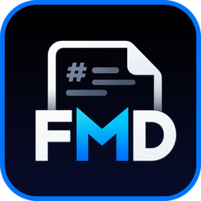

  

<h1 align="center">FMD</h1>

  A fast, native Markdown reader and editor for Windows. 
  Free for everyone, including commercial use.

  <a href="../../releases/latest"><strong>⬇ Download the latest version</strong></a>

---

FMD opens your `.md` files and shows them exactly as written, with clean typography, an outline sidebar and a dark mode. When you want to change something, switch to the editor with a live preview. When you want to ask an AI about it, export it in the format that assistant reads best.

## Features

### Read
- Clean, book-like typography with serif or sans-serif text
- Outline sidebar that jumps to any heading
- Reading progress bar, word count and estimated reading time
- Light, dark or system theme, including the Windows title bar
- GitHub-style alerts: `[!NOTE]`, `[!TIP]`, `[!IMPORTANT]`, `[!WARNING]`, `[!CAUTION]`
- Code blocks with syntax highlighting and a **Copy** button
- Tables, task lists, nested lists, quotes, and local or online images
- Links to other `.md` files open inside FMD
- Reloads automatically when the file is saved in another program

### Edit
- Three views: **Read**, **Split** (editor and live preview side by side) and **Edit**
- Markdown syntax highlighting, line numbers, and find and replace
- Formatting bar for headings, bold, italic, lists, tasks, links, images, code blocks and tables
- Keeps your file's original encoding and line endings
- Warns you about unsaved changes, and asks which version to keep if the file changes elsewhere

### Export for AI
Prepare any document for an AI assistant in one click (`Ctrl+Shift+E`). Your content is never rewritten; only the layout changes to suit each assistant.

| Target | How the document is prepared |
|---|---|
| **Claude** | XML document tags, the structure Anthropic recommends for long documents |
| **ChatGPT** | Markdown headings with the document in a fenced block |
| **Gemini** | Context first, then the task, as Google suggests for long inputs |
| **Any AI** | Simple BEGIN and END markers that work with any chatbot |
| **Compact** | Tightened Markdown that uses fewer tokens |

Preview the result with an estimated token count, then copy it or save it as a file. FMD never sends anything to any AI service.

## Install

1. Download **`FMD-Setup-1.1.0.exe`** from the [latest release](../../releases/latest).
2. Run it and follow the steps.
3. Double-click any `.md` file, or right-click it and choose **Edit with FMD**.

**Requirements:** Windows 10 or Windows 11, 64-bit. Nothing else to install.

> **"Windows protected your PC"?** Windows SmartScreen shows this for new apps that don't have a paid code-signing certificate yet. Click **More info**, then **Run anyway**.

> **Your `.md` files open in another program?** Windows doesn't let installers change a default app you already picked. Right-click a `.md` file › **Open with** › **Choose another app** › **FMD** › **Always**.

## Keyboard shortcuts

| Shortcut | Action |
|---|---|
| `Ctrl+O` | Open a file |
| `Ctrl+N` | New document |
| `Ctrl+S` / `Ctrl+Shift+S` | Save / Save as |
| `Ctrl+1` / `Ctrl+2` / `Ctrl+3` | Read / Split / Edit view |
| `Ctrl+E` | Switch between Read and Split |
| `Ctrl+Shift+E` | Export for AI |
| `Ctrl+B`, `Ctrl+I`, `Ctrl+K` | Bold, italic, link |
| `Ctrl+F` | Find and replace |
| `Ctrl+Shift+B` | Show or hide the outline |
| `Ctrl +` / `Ctrl −` / `Ctrl+0` | Text size (also `Ctrl` + mouse wheel) |
| `F5` | Reload the file |
| `F1` | About FMD |

## Privacy

FMD has no accounts, analytics or tracking. It only goes online to load images that your documents link to, and to open links you click in your browser. Your settings stay on your computer.

## Uninstall

Open **Settings › Apps › Installed apps**, find **FMD** and choose **Uninstall**.

## License

FMD is **freeware**: free to download and use for personal, educational and commercial purposes. It is not open source, and it may not be modified, decompiled or sold. See the [license agreement](LICENSE) for the full terms.

FMD uses open-source components (Markdig, AvalonEdit and .NET), listed with their licenses in [THIRD-PARTY-NOTICES.txt](THIRD-PARTY-NOTICES.txt).

---

  <a href="https://freddydeveloper.com">© 2026 by FreddyDeveloper</a>. All rights reserved.

